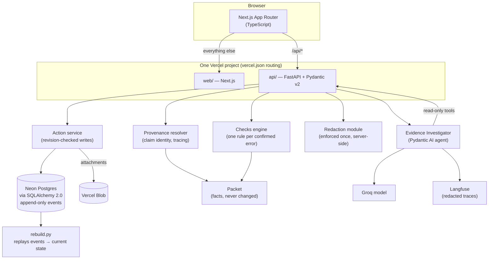

# Proofline

**Every number, traced to its proof.**

Proofline is an evidence-aware tax review workpaper for a CPA team reviewing a household's 2025 tax return.

Tax preparation software has already extracted the documents and computed the return. Proofline addresses the next challenge: **How can a CPA verify where every number came from, investigate discrepancies, document professional judgment, and confidently review the return?**

Instead of relying on disconnected spreadsheets, source files, and review notes, Proofline brings evidence, calculations, and human decisions into one traceable workflow.

**[Live Application](https://proofline-ochre.vercel.app/queue)** · [Source Code](https://github.com/Hemanath17/proofline)

## Product Preview

<!-- Add an actual screenshot of the loaded application. -->


*Review cases by priority, investigate discrepancies, inspect source evidence, and track decisions without losing context.*

## Core Capabilities

**1. Bidirectional Evidence Traceability**

Trace a return value back through its calculation and supporting documents. Navigate in the opposite direction to see where a source document was used—or why it was excluded.

**2. Independent Verification and Reconciliation**

Run checks independently of the supplied tax engine, identify inconsistent amounts, reconcile source documents, and distinguish verified information from unresolved discrepancies.

**3. Case-Based CPA Review**

Investigate issues through structured review cases, document supporting evidence, submit proposed corrections, and enforce independent reviewer and partner approvals.

**4. Versioned Decisions and Audit History**

Preserve original source evidence and historical decisions. Every workflow action generates an audit event, and decisions are tied to specific revisions and supporting information.

**5. Filing Readiness and Historical Records**

Track review completeness, approvals, and filing prerequisites. Demonstrate simulated e-file events and retain versioned filing records for post-filing review.

## System Architecture



| Layer | Technology |
|---|---|
| Frontend | Next.js, React, TypeScript |
| Backend | FastAPI, Python, Pydantic |
| Database | Neon PostgreSQL, SQLAlchemy, Alembic |
| File storage | Vercel Blob |
| AI investigator | Pydantic AI, Groq |
| Observability | Langfuse |
| Testing | pytest, Vitest, DeepEval |

### Key Engineering Decisions

- **Immutable source evidence:** Original packet data is preserved; corrections are represented as adjustments.
- **Deterministic financial checks:** Reconciliation and calculation validation remain separate from AI-generated suggestions.
- **Bidirectional provenance:** Claims connect source documents, extracted values, calculations, and dependent return lines.
- **Transactional workflow:** Audit events and resulting current state are written atomically.
- **Version-scoped approvals:** Changes to approved evidence or values trigger targeted re-review.
- **Server-side authorization:** Read and write permissions are enforced by the backend, with sensitive-data redaction.

## AI Evidence Investigator

Proofline includes an optional AI-assisted evidence investigation workflow.

The investigator uses authorized, read-only tools to retrieve relevant case information and supporting records, then generates structured suggestions for CPA review.

Its design emphasizes:

- **Tool calling:** Evidence access through controlled backend interfaces.
- **Structured outputs:** Pydantic schemas for investigation results.
- **Grounding:** Validation of referenced claims, documents, and numerical values.
- **Human oversight:** AI cannot adjust financial values, approve review cases, or sign returns.
- **Observability and evaluation:** Tracing and evaluation infrastructure for investigating model behavior.

The deterministic workpaper remains functional without the AI investigator.

## Explore the Application

Start from the [Review Queue](https://proofline-ochre.vercel.app/queue) and explore these workflows:

1. **Review a discrepancy:** Open a flagged case, inspect supporting evidence, and examine its review history.
2. **Trace a tax value:** Follow a Form 1040 number back to the supporting source document fields.
3. **Inspect a tax area:** Explore reconciliations, exceptions, verification status, and sign-off requirements.
4. **Explore versioning:** Examine how adjustments and corrected documents affect review decisions.
5. **Inspect the AI Investigator:** Where enabled, review evidence-grounded suggestions without granting the model approval authority.

Use the application's **Demo Role Switcher** to explore different authorized workflows.

## Running Locally

### Prerequisites

- Python and Node.js versions compatible with the project
- npm
- Vercel CLI
- A configured PostgreSQL database

### Installation

```bash
git clone https://github.com/Hemanath17/proofline.git
cd proofline

python3 -m venv .venv
source .venv/bin/activate

pip install -r api/requirements.txt
npm --prefix web install

cp .env.example .env.local
# Configure the required environment variables.

alembic -c api/alembic.ini upgrade head

vercel dev
```

Depending on the local Vercel configuration, the project may need to be linked to a Vercel project before starting. Check `.env.example` for required settings.

### Running Tests

```bash
# Backend unit and contract tests, excluding live AI evaluations
pytest api -q -m "not eval"

# Frontend type checking
npm --prefix web run typecheck

# Independent tax-check baseline
PYTHONPATH=api python3 -m proofline.checks.baseline
```

AI evaluations require their own configured model credentials and should not be reported as passing until executed successfully.

## Documentation

The repository contains additional implementation notes covering:

- Core product and architectural decisions
- Domain and workflow contracts
- User experience and review flows
- Identified tax-packet discrepancies
- Acceptance testing and simulations

See the [`docs/`](docs/) directory.

## Scope and Limitations

Proofline was developed for a fictional **Okafor–Lindqvist 2025 tax engagement**.

The application is an engineering prototype, not production tax-filing software.

- **Tax calculations:** The supplied tax engine cannot be rerun. Exact source arithmetic is distinguished from estimated downstream tax effects.
- **Filing:** Electronic filing events and signatures are simulations.
- **Authentication:** The Demo Role Switcher is not a replacement for production authentication.
- **AI:** Generated suggestions require validation and professional review.
- **Data:** All individuals, source documents, and tax information are fictional.

---

**Proofline — Every number, traced to its proof.**